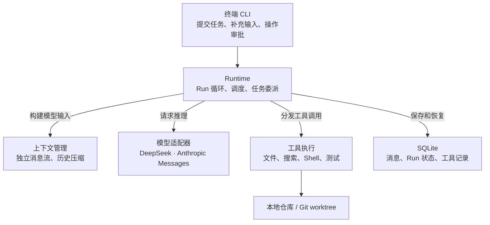

# Keyline

Keyline 是一个面向长程软件工程任务的本地 Coding Agent。它通过命令行在本机仓库中分析代码、修改文件、运行测试，并将进度保存到本地，让任务可以在等待用户输入或进程重启后继续。

## 系统架构



一个 **Session** 对应一个工作区，容纳多次任务执行。每次执行是一个 **Run**，绑定一份 **AgentSpec**，由它定义角色指令、模型和可用工具。连续的主 Run 沿用同一条消息流，每个子 Run 有自己的消息流和上下文。 [状态模型](src/keyline_agent/runtime/state.py) · [Agent 配置](src/keyline_agent/runtime/agents.py)

1. **执行一轮。** Runtime 组装角色指令、运行状态和当前消息历史，请求模型决定下一步，再执行工具调用并写回结果。上下文达到阈值时先缩减旧工具输出，必要时再压缩历史。较长的工具输出可以通过本地 Artifact 按需读取。 [Agent Loop](src/keyline_agent/runtime/loop.py) · [上下文管理](src/keyline_agent/context/manager.py)
2. **等待与恢复。** 用户补充的文本或敏感输入绑定到具体的等待项，收到后续接原 Run。Shell 命令默认逐次审批，敏感值通过专用路径交给命令。工作区工具执行前后会保存断点，重启后按工具的重放策略恢复。普通 Shell 命令的结果如果无法确认，Runtime 会停下来报告该调用。 [输入处理](src/keyline_agent/cli.py) · [工具执行与重放](src/keyline_agent/runtime/tool_execution.py) · [SQLite 存储](src/keyline_agent/storage/sqlite.py)
3. **委派与汇合。** 主 Run 可一轮委派多个探索、审查或实现任务。可运行的子 Run 可以并发请求模型，工作区工具串行执行。一个子 Run 等待输入时，其他子 Run 仍可推进。整批结束后，主 Run 一次收到结构化结果。实现任务在独立的 Git worktree 里修改，主 Run 可以检查 diff 和测试结果，再选择合入。 [调度器](src/keyline_agent/runtime/scheduler.py) · [任务委派](src/keyline_agent/runtime/delegation.py)

## 评测

- **端到端修复（Verified80）**。使用基线版本 `403cd47` 和 `deepseek-flash` 在 SWE-bench Verified 的固定 80 题子集上评测。以全部 80 题为分母，只将通过官方评分的题目计为解决。最终解决 **58/80 题（72.5%）**，其余 **22 题**计为失败。
- **工具调用（Tool Calling）**。评估 12 条运行轨迹中的 694 次工具调用，检查工具选择和参数是否符合任务意图。工具选择平均 **4.28/5**（覆盖 551/694 次），参数准确性平均 **4.65/5**（覆盖 550/694 次），均按有效评分计算。
- **上下文压缩（Compaction）**。6 个固定样本各运行 3 次。17 次可计算压缩比的运行中，被替换内容的压缩比中位数为 **1.55×**。各次运行累计有 79 项待评关键信息，其中 72 项获得有效评分，均被完整保留。14 次获得事实一致性评分，均为 **2/2**。

用工具轨迹、候选 Patch 和官方判分复盘失败案例，改进了搜索空结果、编辑冲突和命令超时的反馈，也调整了 Agent 的验证与收尾指令。 [Verified80 任务清单](evals/datasets/verified80/tasks.toml) · [评测运行方式](evals/README.md)

## 在自己的仓库里运行

需要 Python 3.11 或更新版本、Git 和 uv。克隆本仓库后，在 Keyline 的仓库根目录运行以下命令。

```bash
uv sync --locked
uv run keyline-agent config set-api-key
uv run keyline-agent run /path/to/repo "复现并修复这个问题，并检查相关回归"
```

`config set-api-key` 通过隐藏输入保存 DeepSeek API Key。也可以通过环境变量 `DEEPSEEK_API_KEY` 提供。Keyline 默认将配置和会话存放在 `~/.keyline-agent`。运行开始时会打印 Session ID，可以用它查看或恢复会话。

```bash
uv run keyline-agent list
uv run keyline-agent inspect <session-id>
uv run keyline-agent resume <session-id>
```

可以在启动时用 `--max-steps` 设置模型轮次上限。达到上限后，可通过 `resume <session-id> --max-steps <total>` 调整累计上限并继续。使用 `uv run keyline-agent --help` 查看完整命令。

## 许可证

本项目使用 [MIT License](LICENSE)。
